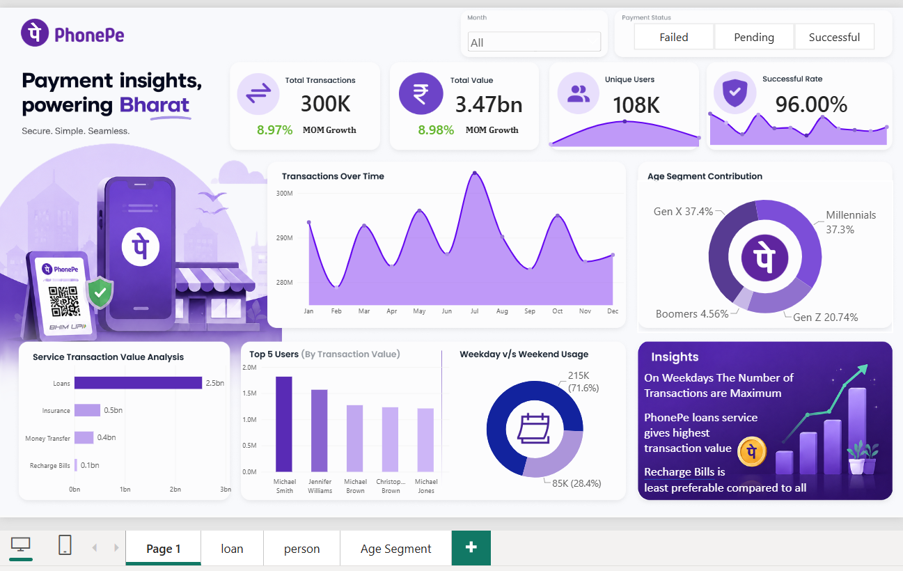

# 📊 PhonePe Transaction Analytics Dashboard | Power BI

An interactive Power BI dashboard designed to analyze PhonePe transaction data, uncover business insights, and understand customer transaction behavior through data visualization.

## 🚀 Project Overview

The **PhonePe Transaction Analytics Dashboard** is a Data Analytics and Business Intelligence project developed using Microsoft Power BI.

The dashboard transforms raw transaction data into meaningful insights by analyzing transaction trends, service performance, customer demographics, and payment behavior.

It provides an intuitive and interactive interface that enables users to explore transaction data using dynamic filters, custom tooltips, and multiple visualizations.

## 🎯 Project Objectives

- Analyze overall transaction performance.
- Identify monthly transaction trends and growth.
- Understand transaction distribution across different services.
- Analyze customer demographics and age segments.
- Identify top users based on transaction value.
- Compare weekday and weekend transaction behavior.
- Present meaningful business insights through interactive visualizations.

## 🖥️ Dashboard Preview



> Replace the image path with your actual dashboard screenshot.

## 📌 Key Performance Indicators (KPIs)

The dashboard highlights the following key metrics:

| KPI | Description |
|---|---|
| Total Transactions | Total number of transactions |
| Total Transaction Value | Overall transaction amount |
| Unique Users | Number of distinct users |
| Successful Rate | Percentage of successful transactions |
| MoM Growth | Month-over-month transaction growth |

### 📈 Dashboard Highlights

The dashboard includes five major analytical visualizations:

1. **Transactions Over Time**  
   Analyzes monthly transaction trends and changes in transaction value.

2. **Age Segment Contribution**  
   Displays transaction contribution across different customer age groups.

3. **Service Transaction Value Analysis**  
   Compares transaction values across services such as Loans, Insurance, Money Transfer, and Recharge Bills.

4. **Top 5 Users by Transaction Value**  
   Identifies users contributing the highest transaction values.

5. **Weekday vs. Weekend Usage**  
   Analyzes transaction behavior across weekdays and weekends.

## ✨ Interactive Features

- **Month Dropdown Slicer:** Filter dashboard data by month.
- **Payment Status Slicer:** Analyze Failed, Pending, and Successful transactions.
- **Custom Report Page Tooltips:** Explore additional transaction details by hovering over visual elements.
- **Multiple Report Pages:** Dedicated pages for transaction analysis, individual users, and age segments.
- **Interactive Visualizations:** Explore data through dynamic filtering and cross-highlighting.
- **Business Insights Section:** Highlights important observations derived from the transaction data.

## 🛠️ Tools & Technologies

| Technology | Purpose |
|---|---|
| Microsoft Power BI | Dashboard development and visualization |
| Power Query | Data cleaning and transformation |
| DAX | KPI calculations and analytical measures |
| Data Modeling | Establishing relationships between tables |
| Excel | Source dataset |

## 🧹 Data Preparation

The dataset was prepared using Power Query and data modeling techniques.

Key data preparation activities included:

- Removing duplicate transaction records.
- Handling blank rows.
- Correcting data types.
- Standardizing service names.
- Formatting transaction dates.
- Creating a dedicated Date Table.
- Establishing relationships between transaction, user, and date tables.

## 📐 DAX Measures

The following DAX measures were used for analytical calculations.

### Total Transactions

```dax
Total Transactions =
COUNTROWS(All_Transactions)
```

### Total Transaction Value

```dax
Total Transaction Value =
SUM(All_Transactions[Amount])
```

### Unique Users

```dax
Unique Users =
DISTINCTCOUNT(All_Transactions[User_ID])
```

### Successful Transactions

```dax
Successful Transactions =
CALCULATE(
    [Total Transactions],
    All_Transactions[Payment_Status] = "Successful"
)
```

### Successful Rate

```dax
Successful Rate =
DIVIDE(
    [Successful Transactions],
    [Total Transactions],
    0
)
```

> Note: These are example measures. The exact calculations may differ depending on the final DAX implementation and business definitions.

## 💡 Business Insights

The dashboard helps explore several business questions:

- Which services contribute the highest transaction value?
- How does transaction value change over time?
- Which customer age segments contribute significantly to transactions?
- Who are the top users based on transaction value?
- Are transactions more frequent on weekdays or weekends?
- What percentage of transactions are successful, failed, or pending?

The insights section communicates key observations in a concise and user-friendly format.

## 📂 Project Structure

```text
PhonePe-Transaction-Analytics/
│
├── README.md
│
├── images/
│   └── phonepe-dashboard.png
│
├── dataset/
│   └── Phonepe-Final-Dataset.xlsx
│
└── PhonePe-Transaction-Analytics.pbix
```

> Update the folder structure according to the actual files in your repository. Do not upload confidential or restricted datasets.

## ▶️ How to Run the Project

1. Download or clone this repository.
2. Install Microsoft Power BI Desktop.
3. Open the `.pbix` file.
4. If required, update the dataset source path in Power Query.
5. Refresh the data.
6. Explore the dashboard using the interactive slicers and visualizations.

## 🎓 Learning Outcomes

Through this project, I strengthened my understanding of:

- Data cleaning and transformation using Power Query.
- DAX measures and calculated metrics.
- Data modeling and table relationships.
- Interactive dashboard development.
- Business intelligence and data storytelling.
- Designing user-friendly analytical reports.

## 🔮 Future Enhancements

- Add transaction success and failure trend analysis.
- Implement drill-through pages for detailed user analysis.
- Introduce additional KPIs and advanced analytical measures.
- Enhance automated business insights.
- Integrate real-time transaction data where an appropriate data source is available.

## 👨‍💻 Author

**Ashraf Shikalgar**

B.Tech Computer Science & Engineering | Artificial Intelligence

Interested in Data Analytics, Business Intelligence, and AI-driven solutions.

🔗 [LinkedIn](https://www.linkedin.com/in/ashraf-shikalgar-29889728b/)  
🔗 [GitHub](https://github.com/Ashraf912005)

---

⭐ If you find this project interesting, feel free to explore the repository and share your feedback!
